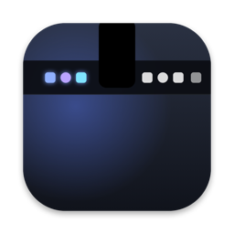
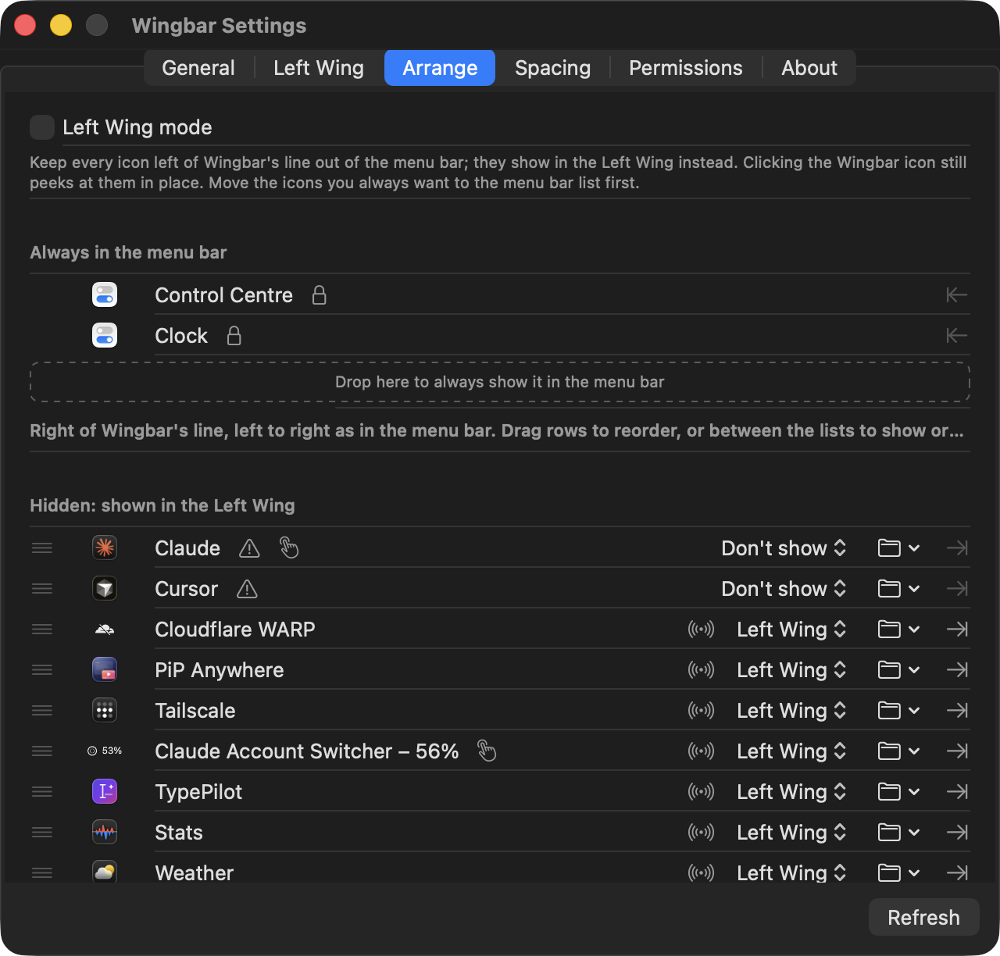
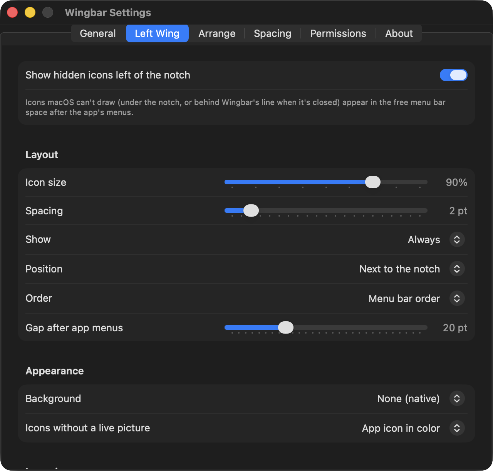
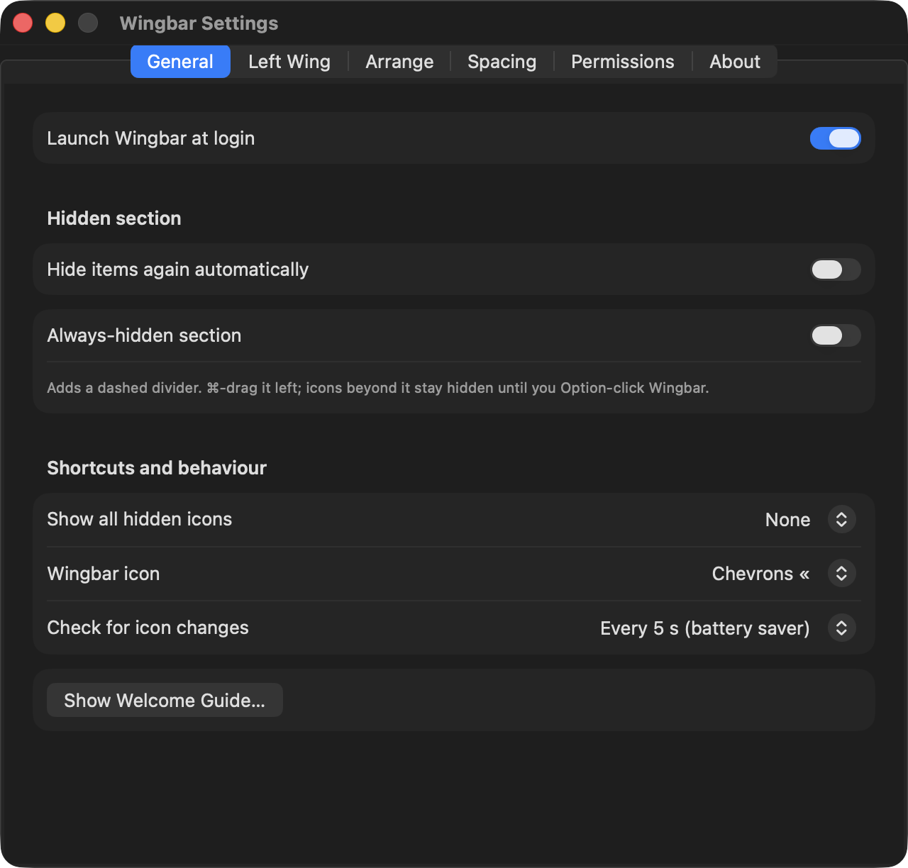

<div align="center">



# Wingbar

**The menu bar icons your MacBook's notch hides, back in view: in the free space on the _other_ side of the notch, looking and working like the real thing.**

[](https://github.com/Naman503/wingbar/actions/workflows/ci.yml)
[](https://github.com/Naman503/wingbar/releases)


[](LICENSE)


<sub>The Left Wing: icons macOS was hiding under the notch, drawn in the empty space after the app's menus.</sub>

</div>

---

## Why

On a MacBook with a notch, status icons fill the menu bar from the right. When the next one would land under the camera housing, **macOS doesn't move it anywhere. It just stops drawing it.** There's no warning and no API that says an icon is hidden, so you just have fewer icons than you thought.

Meanwhile the left side of the menu bar usually has a few hundred points of **empty space** between the app's last menu (*Help*) and the notch.

Wingbar puts the hidden icons in that empty space:

- 🪽 **A second wing.** Overflowing icons appear left of the notch, as live pictures of the real icons, at their real size.
- 🖱️ **They work.** Click one and its own menu opens right under it, or Wingbar briefly moves the real icon into view and clicks it for you.
- 🧩 **You arrange both sides.** Drag icons between "always in the menu bar" and "Left Wing", in any order.

## Highlights

| | |
|---|---|
| **Left Wing** | Hidden icons drawn in the free menu bar space left of the notch, packed against it like a continuation of the bar |
| **Native menus** | Standard menus (Tailscale, TypePilot, ChatGPT…) open as a native copy right under the Left Wing icon; choosing an entry runs the real one |
| **Move engine** | Apps that only open from their own icon (popovers, Apple's modules) get moved into view with a synthetic ⌘-drag, clicked, and put back where they were |
| **Arrange** | Drag-and-drop list of both sides that mirrors the real menu bar; drop between lists to show or hide an icon |
| **Customizable** | Icon size, spacing, position, order, background, groups, per-icon rules, overflow bar, hover-to-show, global shortcut |
| **Light on resources** | Native Swift/AppKit, event-driven, no web views, no network; Screen Recording only when it needs a new picture |

## Features

### 🪽 The Left Wing

- Shows every icon macOS isn't drawing: icons **under the notch**, icons macOS **couldn't fit at all** (they get no window, just an off-screen placeholder), and icons **behind Wingbar's line** when the hidden section is closed.
- Sits between the front app's last menu and the notch, and **re-fits itself** whenever you switch apps (Xcode's long menu bar leaves less room than Finder's).
- Icons are **pictures of the real icons**, so they match your menu bar's light or dark look. Icons Wingbar can't picture show as monochrome glyphs made from the app icon.
- When it's full, the rest go behind a **‹** button that opens a glass bar (or a list with names) under the notch.
- Hidden over **full-screen apps** and when the menu bar auto-hides.

### 🖱️ Opening hidden icons

Wingbar picks the best way for each app, and remembers what works:

1. **Native menu copy.** If the icon has a standard menu, Wingbar reads it through Accessibility (titles, ✓ marks, shortcuts, submenus) and shows a native copy under the Left Wing icon. Choosing an entry presses the real menu item.
2. **Accessibility press.** Popover apps that accept it open directly.
3. **Move into view.** For apps that only respond to their own icon (popovers such as Claude Account Switcher or Cloudflare WARP, and Apple's Control Centre modules), Wingbar ⌘-drags the real icon next to its line, clicks it, waits for the popover to close, then moves it back to its exact slot. If an app ignores even that click, the icon waits there for you to click it.

The move engine never acts while the menu bar is hidden (full-screen apps) or while you're using the mouse, and it can be turned off.

### 🧩 Arrange



- **Two lists that mirror the real menu bar**, left to right: *Always in the menu bar* (right of Wingbar's line) and *Hidden: shown in the Left Wing*.
- **Drag a row onto another** to put it there, or **between the lists** to show or hide it. Wingbar moves the real icons; Clock and Control Centre stay where macOS keeps them.
- **Left Wing mode** keeps every hidden icon out of the menu bar, so they show only in the Left Wing.
- Per icon: show in the Left Wing, only in the overflow, or not at all; put it in a **group** (one Left Wing spot with a symbol, opening the rest); keep its picture **live**.

### 🎛️ Customize

<p>


</p>

- **Left Wing:** icon size (60–100%), spacing, position (next to the notch or after the app's menus), order (menu bar or alphabetical), gap after the app's menus, background (none, subtle pill or separator line), shown always or only while the pointer is on the menu bar.
- **Icon pictures:** *Capture once* (default; each picture is saved and reused, so Screen Recording is only used for icons Wingbar hasn't seen), *Live*, or *Off*.
- **Overflow:** icon bar or list with names; optional hover-over-the-notch to show everything.
- **Right side:** order, and which side each icon lives on; system-wide icon spacing with *Apply Now* (relaunches menu bar apps after asking, instead of waiting for the next login).
- **General:** launch at login, global shortcut for all hidden icons (⌥⌘B, ⌃⌥Space or ⌃⌥⌘M), Wingbar icon style, scan frequency (down to battery-saver), auto-hide for the hidden section, optional always-hidden section.
- Click **Wingbar's line** in the menu bar to open or close Settings.

## Install

There's no signed release yet. Build it from source (below); it takes about a minute.

On first launch Wingbar asks for:

- **Accessibility (required):** to see which app owns each icon, read and press their menus, and move icons.
- **Screen Recording (optional):** to picture icons exactly as they look. With *Capture once*, it's only used for icons Wingbar hasn't seen before, and you can turn it off entirely.

## Privacy

- Wingbar makes **no network requests**. Nothing leaves your Mac.
- Icon pictures are cropped to the single icon and stored only in `~/Library/Application Support/Wingbar/Icons`. *Delete Saved Pictures* in Settings removes them.
- Settings are kept in the app's own preferences (`dev.naman.wingbar`).

## How it works

Status items on macOS 26 are windows owned by Control Centre, so Wingbar joins two views of them:

- The **window list** gives each item's window ID and whether it's drawn.
- **Accessibility** (each app's "extras menu bar") gives the real owner, the true position and the menu.

Hiding uses a divider status item that grows to push everything left of it off screen, as other menu bar managers do. Pictures come from ScreenCaptureKit, which can capture an item's window even while it sits under the notch. Moves are synthetic ⌘-drags delivered both to the session and to the item's app.

The details, including what didn't work, are in [docs/research.md](docs/research.md) and [spike/FINDINGS.md](spike/FINDINGS.md).

## Limitations

- **Other apps' real icons can't be resized**; each app draws its own. Spacing is a system-wide setting.
- An icon macOS couldn't fit at all has **no window**, so it can't be pictured or moved; it shows as a glyph and opens through its menu when it has one.
- Drops land reliably only at visible spots, so reordering two icons that are both under the notch only changes the Left Wing's order.
- Wingbar uses Accessibility and posts events to other apps, which the Mac App Store doesn't allow.

## Build from source

Requires macOS 14+ and Xcode 16+ (Xcode 26 adds Liquid Glass to the overflow bar).

```bash
git clone https://github.com/Naman503/wingbar.git
cd wingbar/app
swift test
scripts/bundle.sh release
open build/Wingbar.app
```

Set `SIGN_IDENTITY` (e.g. `"Apple Development: …"`) when bundling to keep the signature stable, so macOS keeps the Accessibility and Screen Recording grants across rebuilds. Without it the app is ad-hoc signed.

Launch flags for development: `--settings[=general|wing|arrange|spacing|permissions|about]`, `--onboarding`, `--dump-scan=<path>` (writes the raw menu bar scan).

### Project layout

```
app/
  Sources/WingbarCore/   pure logic (notch geometry, item matching, layout, preferences), unit-tested
  Sources/Wingbar/       the menu bar app: scanner, Left Wing, move engine, menus, settings
  Tests/                 XCTest suite for WingbarCore
  scripts/               bundle.sh (builds Wingbar.app), make-icon.sh
spike/                   Phase 0 spike used to prove each technique on macOS 26, with FINDINGS.md
docs/                    research and plan, README images
```

## License

[MIT](LICENSE) © 2026 Naman Pathak
